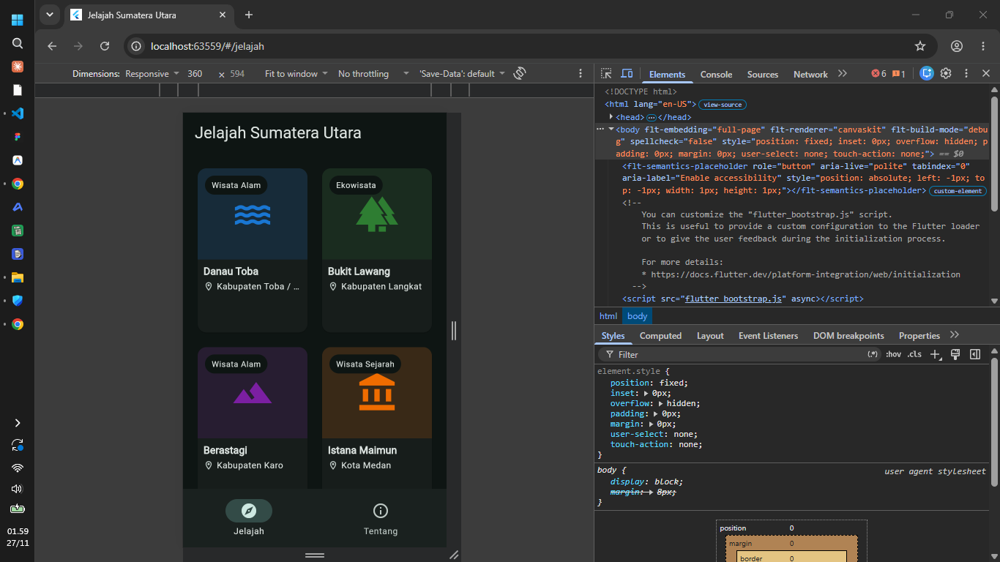
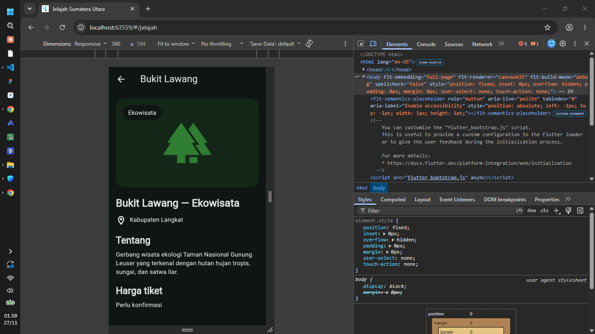
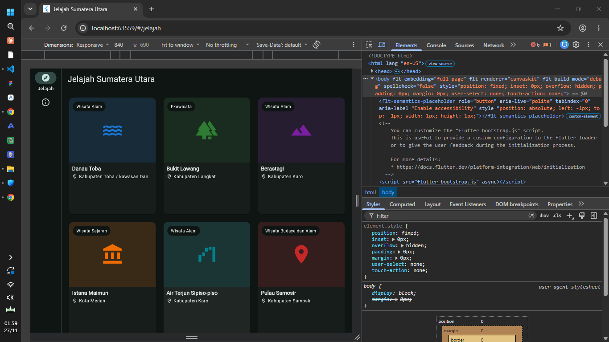
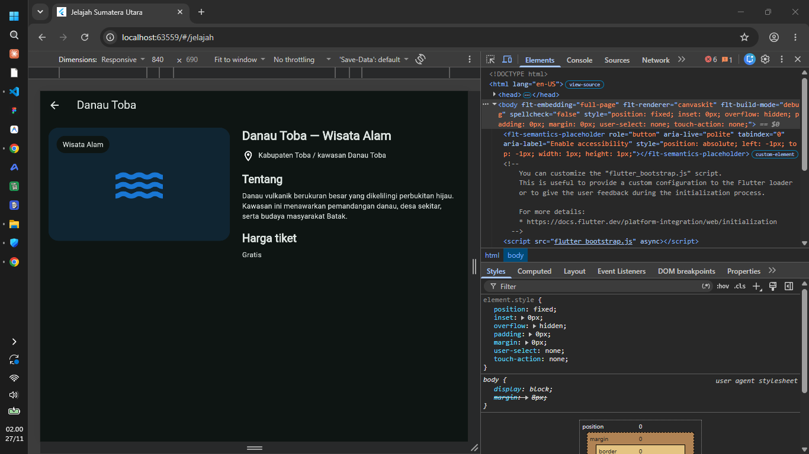

# Jelajah Sumatera Utara

Aplikasi katalog wisata Sumatera Utara berbasis Flutter yang dirancang dengan tampilan responsif untuk berbagai ukuran layar, mulai dari ponsel hingga desktop.

## Identitas Proyek

| Keterangan | Detail |
|---|---|
| Nama Proyek | Jelajah Sumatera Utara |
| Mata Kuliah | Pemrograman Mobile |
| Framework | Flutter |
| Bahasa Pemrograman | Dart |
| Institusi | Universitas Negeri Medan |

## Deskripsi

Jelajah Sumatera Utara merupakan aplikasi katalog wisata yang menampilkan berbagai destinasi menarik di Sumatera Utara. Pengguna dapat melihat daftar destinasi, membuka halaman detail untuk memperoleh informasi lebih lanjut, serta berpindah halaman melalui navigasi aplikasi.

Aplikasi ini dikembangkan dengan menerapkan konsep responsive layout agar antarmuka dapat menyesuaikan ukuran layar perangkat yang berbeda.

## Fitur Utama

- **Katalog Destinasi:** Menampilkan minimal enam destinasi wisata Sumatera Utara.
- **Detail Destinasi:** Menampilkan informasi setiap destinasi melalui halaman tersendiri.
- **Responsive Grid:** Mengatur jumlah kolom berdasarkan lebar layar.
- **Responsive Navigation:** Menggunakan NavigationBar pada layar kecil dan NavigationRail pada layar lebar.
- **Responsive Detail Layout:** Mengubah susunan konten dari vertikal menjadi berdampingan sesuai ukuran layar.
- **Routing:** Menggunakan GoRouter untuk navigasi dan parameter ID destinasi.
- **Tema:** Mendukung tampilan terang dan gelap.

## Destinasi Wisata

Aplikasi menyediakan enam destinasi wisata:

1. Danau Toba
2. Bukit Lawang
3. Berastagi
4. Istana Maimun
5. Air Terjun Sipiso-piso
6. Pulau Samosir

## Teknologi yang Digunakan

- Flutter
- Dart
- Material UI
- GoRouter
- Widget Testing

## Struktur Proyek

```text
pm-tugas-06-4243250045/
├── lib/
│   ├── data/
│   │   └── data_destinasi.dart
│   ├── models/
│   ├── pages/
│   ├── routes/
│   │   └── app_router.dart
│   ├── utils/
│   ├── widgets/
│   └── main.dart
├── test/
│   └── widget_test.dart
├── screenshots/
│   ├── daftar-ponsel.png
│   ├── detail-ponsel.png
│   ├── daftar-tablet.png
│   └── detail-tablet.png
├── pubspec.yaml
├── pubspec.lock
└── README.md
```

## Instalasi dan Menjalankan Aplikasi

Pastikan Flutter SDK sudah terpasang. Kemudian jalankan perintah berikut dari direktori proyek:

```bash
flutter pub get
```

Untuk menjalankan aplikasi melalui Chrome:

```bash
flutter run -d chrome
```

Untuk memeriksa kode:

```bash
flutter analyze
```

Untuk menjalankan pengujian:

```bash
flutter test
```

## Implementasi Responsive Design

Responsive design diterapkan dengan memanfaatkan MediaQuery, LayoutBuilder, dan beberapa widget pengatur tata letak Flutter. MediaQuery digunakan untuk memperoleh informasi ukuran layar perangkat, sedangkan LayoutBuilder digunakan untuk menyesuaikan komponen berdasarkan batasan ruang yang tersedia.

Pada halaman katalog, jumlah kolom GridView disesuaikan dengan lebar layar. Layar di bawah 600 dp menggunakan dua kolom, layar 600–1023 dp menggunakan tiga kolom, sedangkan layar mulai 1024 dp menggunakan empat kolom. Dengan demikian, tampilan katalog dapat memanfaatkan ruang layar secara lebih efektif.

Pada halaman detail, susunan konten menggunakan Column untuk layar dengan lebar di bawah 840 dp. Ketika lebar layar mencapai 840 dp atau lebih, susunan berubah menjadi Row agar gambar dan informasi destinasi dapat ditampilkan berdampingan.

Navigasi juga menyesuaikan ukuran layar. NavigationBar digunakan pada layar di bawah 840 dp, sementara NavigationRail digunakan pada layar yang lebih lebar. Widget seperti Expanded, Flexible, dan TextOverflow.ellipsis turut digunakan untuk membantu mengatur ruang komponen dan mencegah teks menyebabkan overflow.

## Routing dan Navigasi

Aplikasi menggunakan package GoRouter untuk mengatur perpindahan halaman.

Halaman detail destinasi menggunakan pola path parameter:

```text
/destinasi/:id
```

ID destinasi diteruskan melalui URL dan dibaca menggunakan `state.pathParameters`. Aplikasi kemudian mencari data destinasi berdasarkan ID tersebut. Jika ID tidak ditemukan, aplikasi akan menampilkan halaman yang sesuai untuk kondisi destinasi tidak tersedia.

## Pengujian

Pengujian dilakukan menggunakan perintah Flutter berikut:

| Perintah | Hasil |
|---|---|
| `flutter pub get` | Berhasil |
| `flutter analyze` | Tidak ditemukan masalah |
| `flutter test` | 6 widget test berhasil |

Pengujian widget mencakup tampilan katalog, navigasi menuju halaman detail, pencarian data destinasi, penanganan ID yang tidak ditemukan, perpindahan tab, dan tampilan pada ukuran layar tablet.

## Screenshot Aplikasi

### 1. Katalog pada Ponsel



### 2. Detail Destinasi pada Ponsel



### 3. Katalog pada Tablet



### 4. Detail Destinasi pada Tablet



## Penggunaan AI

AI digunakan sebagai alat bantu dalam proses pengembangan, khususnya untuk penyesuaian responsive layout, dan debugging. Implementasi dan pengujian akhir dilakukan pada proyek lokal.